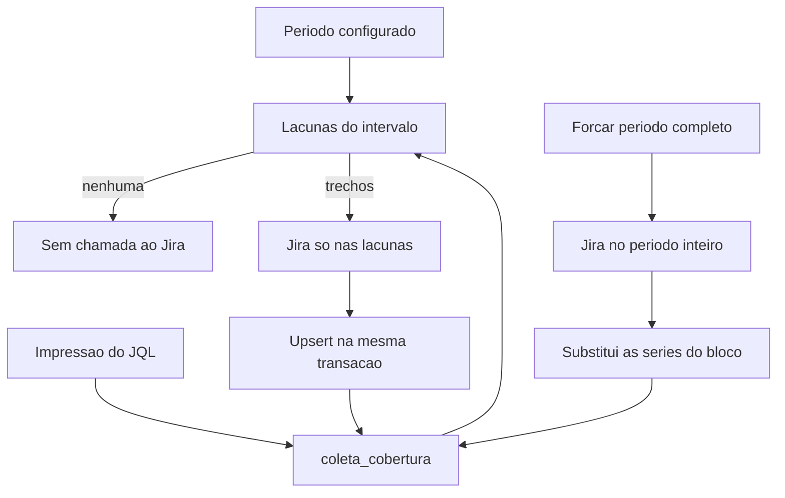

# Cobertura incremental da sincronia Jira

## Contexto

Cada bloco em [internal/coleta/blocos.go](internal/coleta/blocos.go) monta um JQL do período inteiro (`params.JQLIntervalo`) e [internal/store/modelos.go](internal/store/modelos.go) apaga a tabela e grava só o resultado (`SubstituirHistorias`, `SubstituirTestBugs`, `SubstituirIncidentes`, `SubstituirWorklogs`). Uma segunda coleta com período sobreposto baixa de novo os meses já obtidos. Em horas, `WorklogsEmMassa` ainda percorre o feed global `/worklog/updated` desde o início do período menos 30 dias.

As métricas em [internal/metrics/calculo.go](internal/metrics/calculo.go) já ignoram linhas fora dos meses pedidos (`indiceMes` e `AbertoNoFimDoMes`). Dá para acumular a união dos períodos no SQLite sem mudar T1, T2 ou T3.

O layout segue [agents.md](agents.md): monólito modular, sem hexagonal formal. A conta dos intervalos fica numa função pura em `coleta` (SRP). Cada bloco continua dono do próprio JQL (o mapa `blocos` já existente). Sem interface nova de repositório e sem padrão GoF: o store concreto e o cliente Jira permanecem como estão.

## Decisão

Intervalo meio-aberto `[inicio, fimExcl)`, o mesmo recorte de `JQLIntervalo` com dia final incluído. A cobertura é um conjunto desses intervalos, por série:

- `historias` — campo `resolved`
- `testbugs` — campo `created`
- `incidentes_criados` — campo `created`
- `incidentes_resolvidos` — campo `resolved`
- `incidentes_estoque` — superconjunto do estoque, não um campo só
- `horas` — campo `worklogDate`

Cada série guarda a impressão do JQL com as datas trocadas por um sentinela fixo (projetos, status, tipos, cláusula de equipe). Se a impressão mudou, a série é apagada e o período configurado é buscado por inteiro. Incluir alguém na equipe, mudar Espaço ou status cai nesse caso. Tirar alguém das horas continua valendo na hora, porque o T2 ainda filtra com `eq.Contem`.

Exemplo de aceite: cobertura `[2026-01-01, 2026-05-01)` e pedido `[2025-12-01, 2026-05-31)` geram só `[2025-12-01, 2026-01-01)` e `[2026-05-01, 2026-05-31)`. Pedido contido na cobertura gera zero chamadas ao Jira.

Trecho já coberto não é rebuscado no caminho padrão. Worklog lançado depois, issue que mudou de data ou status dentro de um mês já gravado só entra de novo quando o usuário força a sincronia completa (seção abaixo) ou quando a impressão do JQL muda.

A primeira coleta depois desta mudança ainda baixa o período inteiro: a tabela de cobertura nasce vazia. Não se infere cobertura pelas linhas já gravadas.

## Estoque

`JQLIncidentesEstoque` não é particionável por um campo. A lacuna depende dos vizinhos já cobertos:

- Sem cobertura: o JQL atual do período inteiro.
- Prefixo `[a, b)` com cobertura começando em `b`: `resolutiondate >= a AND resolutiondate < b AND created < fim do pedido`, mais projeto, tipo e status.
- Sufixo `[c, d)` com cobertura terminando em `c`: `created >= c AND created < d` e ainda aberto ou resolvido a partir do início do pedido.
- Buraco interno `[a, b)` com cobertura dos dois lados: `created >= a AND created < b AND resolutiondate >= a AND resolutiondate < b`.

Issue aberta ou resolvida fora do buraco já está no superconjunto vizinho. O upsert usa a chave `(chave, tipo_registro)` e não apaga as linhas de estoque já gravadas.

## Horas

Sem cobertura, o modo bulk atual permanece (`WorklogsEmMassa` junto com o JQL do período). Com lacunas, o JQL de issues usa só `worklogDate` da lacuna e os worklogs saem por issue (`WorklogsDeIssues`), filtrados à lacuna. O feed global `since` não roda de novo, porque ele não respeita o intervalo de `worklogDate`.

## Persistência

Nova tabela no `CREATE TABLE IF NOT EXISTS` de [internal/store/store.go](internal/store/store.go), no mesmo padrão do arquivo (sem Flyway):

- `coleta_cobertura(serie, impressao, inicio, fim_excl)`
- índices por `serie`

Gravação de uma série bem-sucedida, numa transação só: upsert das linhas novas e substituição dos intervalos daquela série pela união já fundida (adjacentes e sobrepostos viram um intervalo). Falha no Jira não grava linha nem cobertura.

`Substituir*` continua para o caso sem equipe, para impressão diferente e para `forcar`. No caminho incremental, métodos `Mesclar*` com `INSERT ... ON CONFLICT DO UPDATE`.

## Forçar sincronia completa

O caminho padrão (botões atuais "Atualizar tudo" e um bloco) segue só nas lacunas. Para um card ou hora já gravado que foi ajustado no Jira, a tela de Sincronização ganha um interruptor **"Forçar período completo"**, desligado por padrão.

- Com o interruptor desligado, o clique manda `{ "bloco": "tudo" | "historias" | "testbugs" | "incidentes" | "horas" }` e a coleta usa a cobertura.
- Com o interruptor ligado, o mesmo clique manda `forcar: true` no bloco escolhido. Antes de iniciar, um diálogo confirma: a consulta volta a percorrer o período configurado inteiro no Jira, inclusive meses já sincronizados, para refletir alteração feita depois da última coleta.
- `Runner.Iniciar` recebe o booleano. `POST /api/sync` em [internal/spaserver/api.go](internal/spaserver/api.go) lê `forcar`. O form em [internal/web/paginas.go](internal/web/paginas.go) e [internal/web/templates/sincronizacao.html](internal/web/templates/sincronizacao.html) têm o mesmo interruptor.
- Efeito no banco: as séries daquele bloco são substituídas pelo resultado fresco do período configurado (`Substituir*`, inclusive horas em bulk e estoque com o JQL cheio). A cobertura dessas séries passa a ser só esse intervalo. Meses que estavam no banco fora do período configurado saem junto, como na sincronia de hoje.
- A etapa da coleta, quando `forcar` está ligado, começa com "Sincronia completa" e o período inteiro. No caminho padrão, a etapa lista as lacunas (`buscando 01/12/2025–31/12/2025 e 01/05/2026–31/05/2026`) ou informa que o período já estava coberto.

## API e texto

- Ajustar o texto que hoje diz que cada bloco substitui os dados anteriores: [frontend/src/pages/sincronizacao.tsx](frontend/src/pages/sincronizacao.tsx), [internal/web/paginas.go](internal/web/paginas.go) e [internal/web/templates/sincronizacao.html](internal/web/templates/sincronizacao.html). O texto passa a dizer que a coleta normal só busca o que ainda não foi sincronizado, e que o interruptor rebusca o período inteiro quando houve ajuste no Jira.
- A tela da SPA já mostra `etapa` e a mensagem do histórico. O interruptor usa o `Switch` de [frontend/src/components/ui/switch.tsx](frontend/src/components/ui/switch.tsx) e a confirmação usa o `Dialog` de [frontend/src/components/ui/dialog.tsx](frontend/src/components/ui/dialog.tsx).

## Fora deste cambio

- Não alterar fórmulas T1, T2 ou T3.
- Não encurtar o máximo de 12 meses.
- Não acrescentar job de refresh do mês corrente.
- Specs: [cobertura-sync-jira.md](../docs/specs/cobertura-sync-jira.md) e [cobertura-sync-jira-technical.md](../docs/specs/cobertura-sync-jira-technical.md).

## Riscos

- Estoque com lacuna classificada errado zera ou infla a vazão. Os testes de JQL do prefixo, sufixo e buraco travam o exemplo de dezembro a maio.
- Impressão esquecendo um pedaço do JQL reutiliza dados de outro filtro. A impressão é o hash do JQL sentinela, não uma lista manual de chaves de config.
- Coleta interrompida no meio de duas lacunas não pode marcar a primeira como coberta. A transação só abre depois que todas as lacunas da série voltaram.

## Verificação

Testes em `internal/coleta` com o Jira falso já usado em [internal/coleta/coleta_test.go](internal/coleta/coleta_test.go):

- Janeiro–abril e depois dezembro–maio: o segundo `BuscarIssues` só contém os dois trechos; histórias, bugs, criados e resolvidos do meio não geram JQL.
- Pedido contido na cobertura: nenhum GET/POST ao Jira e as métricas do período interno permanecem.
- Mudança de `projetosHistorias` ou de alguém incluído na equipe: o JQL volta a ser o período inteiro.
- Interruptor desligado: janeiro–abril já coberto e um segundo clique no mesmo período não chama o Jira.
- Interruptor ligado (`forcar: true`): o mesmo período gera de novo o JQL inteiro, as tabelas do bloco são substituídas e a cobertura fica só nesse intervalo.
- Horas com cobertura parcial: não chama `GET /rest/api/3/worklog/updated`.

Gates do Go, na raiz do módulo: `gofmt`, `go vet ./...`, `go test ./...`. No front: `npm run lint`, `npm run fmt:check`, `npx tsc -b`, `npm test` em `frontend/`. No browser, na tela Sincronização: coleta normal sem o interruptor, e o fluxo com "Forçar período completo" (diálogo de confirmação e corpo `forcar: true`).